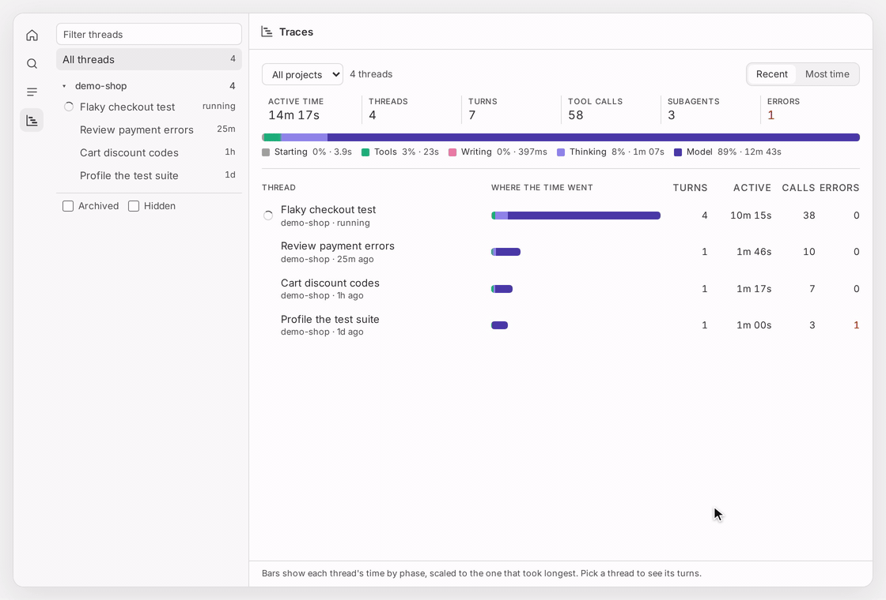

# Agent Traces plugin

Shows where an agent's time goes, and why. Open **Traces** in the sidebar to
see every thread, or **Trace** from a thread's side panel to see every turn of
that thread. Pick a turn to see its waterfall: each command, tool call,
subagent, and spawned thread on one timeline, with the agent's own time split
into what it was doing.



The demo replays real agent threads working on a small sample repository; the
running turn plays at 10× speed.

## Install

From the marketplace:

```sh
bb marketplace add git:github.com/charpeni/bb-plugins@main
bb plugin install agent-traces@charpeni
```

Or directly from this repository:

```sh
bb plugin install git:https://github.com/charpeni/bb-plugins.git@^1.0.0 --tag-prefix agent-traces/ --plugin agent-traces
```

Requires bb 0.47 or newer.

Then open **Traces** in the sidebar's navigation. From a thread, choose
**Trace** from the side panel's actions, use **Trace this turn** on any chat
message, or run **Agent Traces: open this thread's trace** from the command
palette (Mod+Shift+P). The **⤢** button opens what the side panel shows in the
Traces page, with room for the whole waterfall.

## The Traces page

The sidebar lists every thread by project, with spawned threads under the
thread that spawned them. **Archived** and **Hidden** at its bottom add those
threads too.

**All threads** compares the most recent threads, 25 at a time: each one's
active time, turns, calls, and errors, with a bar of where its time went. Sort
by **Most time** to find the threads that took longest, or pick a project. A
thread's totals are read once and again only when it changes, and a running
thread keeps counting.

Pick a thread for the same views as the side panel: its turns, its commands,
one turn's waterfall, or two turns compared. Each has its own link, so browser
back and forward walk through them, and **Open thread** in the header returns
to the conversation.

## Where the time went

Every moment of an agent's turn gets one phase, so the phases add up to the
turn:

| Phase          | Means                                                                          |
| -------------- | ------------------------------------------------------------------------------ |
| Tools          | Commands and tool calls the agent waited on                                    |
| Subagents      | Waiting on subagents with nothing else running                                 |
| Thinking       | The agent's visible thinking                                                   |
| Writing        | The agent streaming its reply                                                  |
| Model          | Model time nothing else explains: response latency and writing tool calls      |
| Waiting on you | Approvals, questions, and forms the agent waited on you for                    |
| Compaction     | Summarizing the conversation to free context                                   |
| Starting       | Between sending the prompt and the agent starting, unless another turn held it |

Background work (dev servers, background subagents, threads it spawned) runs
alongside the agent, so it never takes a moment away from these phases.
Provider errors, bb errors, and stops show as red markers where they happened.

## What it shows

- **Turns**: one row per turn, its bar split by phase. Sort by newest or
  longest, or pick two turns to **Compare**: where the time moved and which
  calls changed, such as before and after you sped up a test script.
- **Commands**: calls grouped by what they ran (`pnpm test`, `git diff`,
  `node bench.mjs`), with runs, total, average, slowest, and failures. Switch to
  **Project** to see the same across the project's 20 most recently active
  threads. A row opens its slowest run.
- **One turn**: the turn's own agent, then every span in start order.
  Subagents and spawned threads fold up to a single bar; expand one to see its
  own spans. The slowest call is tagged, failed spans are red, and a running
  turn grows live. Select a span for its exit code, error, output, and
  arguments, and **Show in chat** jumps to the reply that followed it. A spawned
  thread's **Open trace** shows its own trace in the panel, with a way back.

The panel opens on the running turn while the agent works, and on the list of
turns otherwise. After that it stays put: a newer turn shows a button instead
of pulling the view away.

## Investigate a turn

| To                          | Do this                                                    |
| --------------------------- | ---------------------------------------------------------- |
| Zoom into a stretch of time | Drag across the minimap, or Ctrl/⌘ + scroll (or pinch)     |
| Pan while zoomed            | Drag the minimap's window, or Shift + scroll               |
| Zoom to one span            | Double-click it, or select it and press Enter              |
| Show the whole turn again   | **Fit**, or press 0                                        |
| Hide the quick stuff        | **≥ 1s** keeps spans that took a second or more            |
| Find a span                 | Type in **Filter spans**; matching subagents open          |
| See what a call did         | Select it; the details pane shows its output and arguments |
| Step through spans          | ↑ ↓ to move, → ← to open and close subagents, Esc to clear |
| Make room for long names    | Drag the edge of the span column; double-click to reset    |

Spans outside the zoomed range, or past the end of the turn, keep their
duration pinned to the edge they went past, so nothing disappears silently.

## From a terminal or an agent

```sh
bb agent-traces show [thread] [--turn n|latest|previous]   # phases, slowest calls, failures
bb agent-traces turns [thread]
bb agent-traces commands [thread] [--project]
bb agent-traces compare <a> <b> [thread]
bb agent-traces export [thread] [--turn n] [--format otlp|html] [--send]
```

Every command takes `--json`. Agents get the same answers from the
`agent_traces` tool, so you can ask one why its last turn was slow.

## Export

The turn view's **Export** menu copies or downloads the turn as OpenTelemetry
(OTLP/JSON), downloads a standalone HTML snapshot for a pull request or bug
report, or sends it to an OTLP/HTTP collector such as Jaeger, Grafana Tempo,
Honeycomb, or Langfuse. Turns become one trace each, with stable ids, so
sending a turn twice updates it. Spans follow the OpenTelemetry GenAI
conventions where they fit (`execute_tool`, `invoke_agent`, `chat`).

Set the collector in **Settings → Plugins → Agent Traces**, or:

```sh
bb plugin config agent-traces set otlpEndpoint http://localhost:4318/v1/traces
bb plugin config agent-traces set otlpHeaders "authorization=Bearer …"   # stored as a secret
bb plugin config agent-traces set autoExport true   # send each turn as it finishes
```

## How spans are built

Everything comes from the thread's own event history:

- A span runs from an item's `item/started` event to its `item/completed`
  event. Its output is read on demand from the event that ended it.
- Subagents run as turns of their own, or as background agent tasks. Their
  spans fold back under the subagent, which lasts until its agent finishes.
- Threads a turn spawned come from bb's parent links, with the spans they ran
  during that turn.
- A call that never reported finishing ends with its turn; after six hours
  without any event, nothing in the thread counts as still running.

## Limitations

- **No cost.** bb does not record a cost for Claude Code, Codex, or OpenCode
  threads, and its history keeps only the latest token count of a thread.
- **Thinking and writing** are only as visible as the provider streams them:
  Claude Code streams its thinking, Codex mostly does not, so more of a Codex
  turn shows as Model.
- **Timing precision** depends on when each provider reports its events. Codex
  gives many quick commands the same start and end time, so they show as `0ms`.
- **OpenCode** reports no subagents, so its turns show a flat list of tool
  calls.
- **Show in chat** jumps to the nearest reply: bb links messages, not
  individual tool calls.

## Develop

From the repository root:

```sh
bb plugin install ./plugins/agent-traces
bb plugin dev plugins/agent-traces
```
